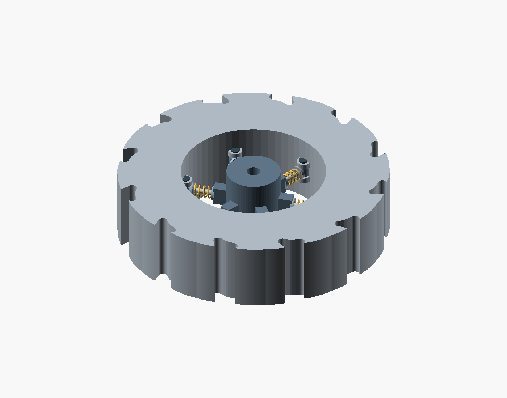
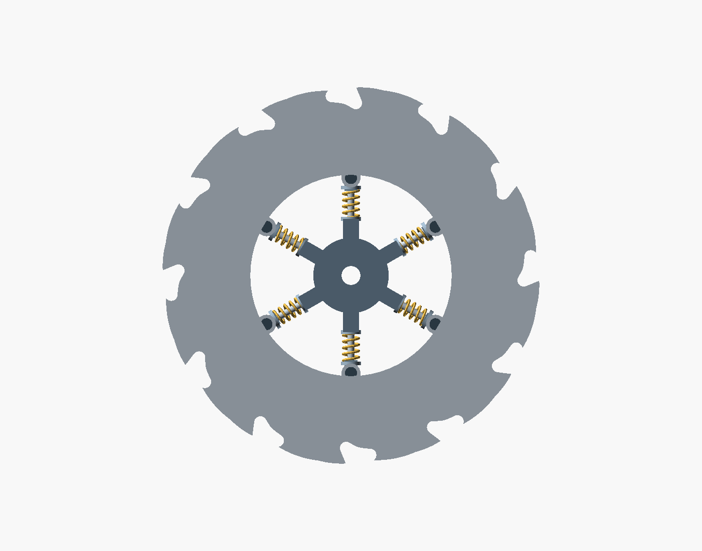
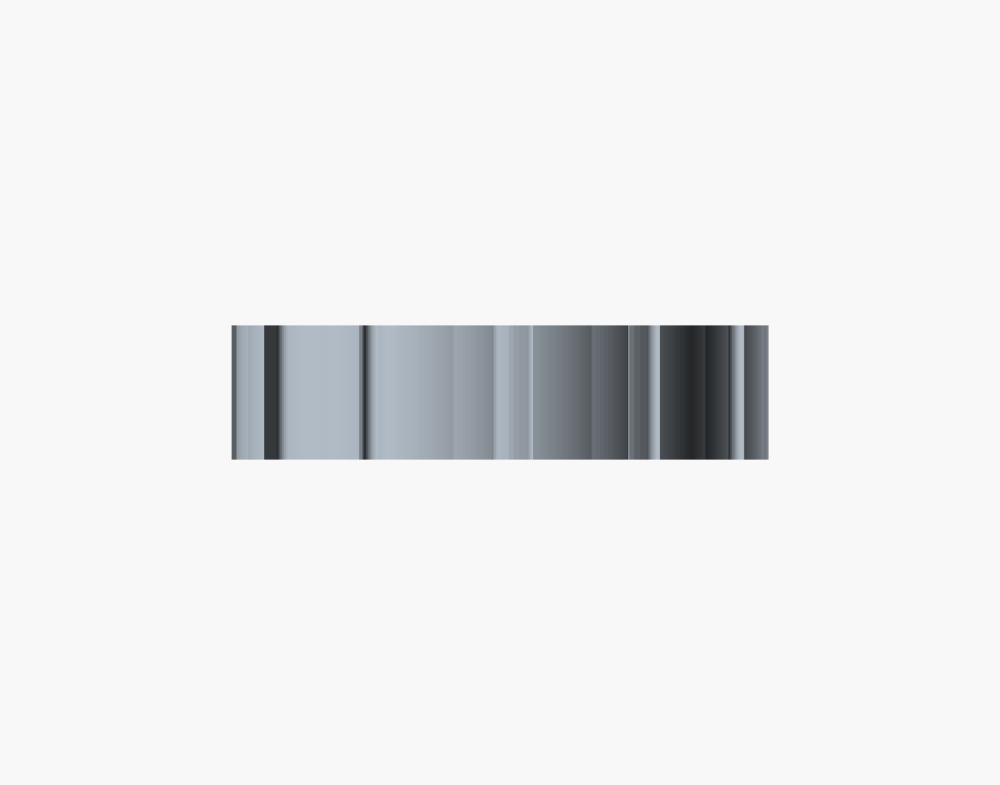

# Offroad Wheel

An all-terrain rover wheel designed for snow, quicksand, gravel, mud and water. A sealed tread ring carries swept forward paddles and smaller teeth facing the opposite direction. Six spring spokes connect the ring to the central hub.



## Three main views

| Front, looking along the axle | Top | Right side |
| --- | --- | --- |
|  |  |  |

The wheel lies in the XY plane. Its principal axis of rotation is Z. The front view looks along that axis; the top and right views show the 30 mm tread width. All four images use orthographic projection.

## Design

**Tread and paddles.** The larger teeth follow circular contact arcs and extend another 4 mm along those arcs in their facing direction. Smaller opposing teeth sit on each long flank to provide a reverse-facing paddle edge. Both sets keep sharp outward peaks. Only the inward valleys are filleted, with a 2 mm radius, to remove narrow corners where pebbles and dirt could collect.

**Buoyancy ring.** The outer tread is a closed shell containing eight air chambers. The teeth remain solid, with 3 mm minimum walls, front and back skins, and radial ribs between chambers. The current export contains about 32.02 cm3 of enclosed air. The tread region is approximately 14.53% hollow and 85.47% solid by volume. There is no exposed cutaway in the working model.

**Suspension and damping.** Six spring spokes are spaced around the principal rotation axis, with pivots at the rim. The arrangement is intended to cushion loads from any direction in the wheel plane, rather than vertical loads alone. The sliding rods and coil springs show the suspension layout. Axial travel along the Z shaft is not modeled. Spring rates, energy dissipation and dynamic damping are not simulated.

## Current dimensions

All source dimensions and STL coordinates are in millimeters.

| Parameter | Value |
| --- | ---: |
| Nominal outside diameter | 120 mm |
| Wheel width | 30 mm |
| Tread ring inside diameter | 64 mm |
| Hub diameter | 24 mm |
| Axle hole diameter | 6 mm |
| Main teeth / opposing teeth | 12 / 12 |
| Forward arc extension | 4 mm |
| Inward valley fillet | 2 mm |
| Minimum shell wall | 3 mm |
| Sealed chambers | 8 |
| Spring spokes | 6 |
| Spring span / coil diameter / wire diameter | 10 / 5 / 0.8 mm |

## Continue the design

Install OpenSCAD and clone the repository:

```sh
git clone https://github.com/A-C-Simon/Offroad-Wheel.git
cd Offroad-Wheel
openscad models/rover_wheel_sprung.scad
```

The model is self-contained. No external OpenSCAD libraries are required. Edit the parameters at the top of the file or use OpenSCAD's Customizer. Press F5 to preview and F6 to render the solid geometry.

| File | Purpose |
| --- | --- |
| [models/rover_wheel_sprung.scad](models/rover_wheel_sprung.scad) | Current editable wheel and assembly |
| [exports/offroad_wheel.stl](exports/offroad_wheel.stl) | Complete assembly mesh |
| [exports/tread_ring.stl](exports/tread_ring.stl) | Tread shell with enclosed chambers |
| [exports/sealed_air_chambers.stl](exports/sealed_air_chambers.stl) | Air-space geometry for inspection; not a manufactured part |
| [archive/zigzag_wheel](archive/zigzag_wheel) | Original wheel source, STL and preview |
| [docs/reference](docs/reference) | Original wheel images and spring-wheel sketch |
| [docs/design-history.md](docs/design-history.md) | Design stages and commit history |
| [docs/validation.json](docs/validation.json) | Mesh checks, dimensions, volumes and file checksums |

The complete assembly STL is an inspection model. Springs, pins, sliding fits and seals still need hardware-specific dimensions before fabrication. Terrain performance, watertightness, fatigue life and flotation have not been tested. Enclosed air alone does not establish whether the wheel can float the rover; total material mass and rover load also matter.

## Rebuild the files

The committed STLs and PNGs can be used directly. Python 3 is needed only for the rebuild and validation scripts. The scripts use the standard library. Exports were checked with OpenSCAD 2021.01.

```sh
python3 scripts/build.py --exports
python3 scripts/build.py --views
python3 scripts/validate.py
```

PNG generation needs a graphics display. On a headless Linux computer with Xvfb installed, use `xvfb-run -a python3 scripts/build.py --views`. If the OpenSCAD executable is not on PATH, set the `OPENSCAD` environment variable to its full path.

The build script regenerates all three current STL exports, the original zigzag-wheel STL, and the four documentation views. Validation checks that every mesh edge has two incident faces and records surface components, bounds, volumes and SHA-256 checksums. These are geometry checks, not load or fluid tests.

For direct component exports:

```sh
openscad -D 'export_part="rim"' -o tread_ring.stl models/rover_wheel_sprung.scad
openscad -D 'export_part="cavity"' -o air_chambers.stl models/rover_wheel_sprung.scad
```
